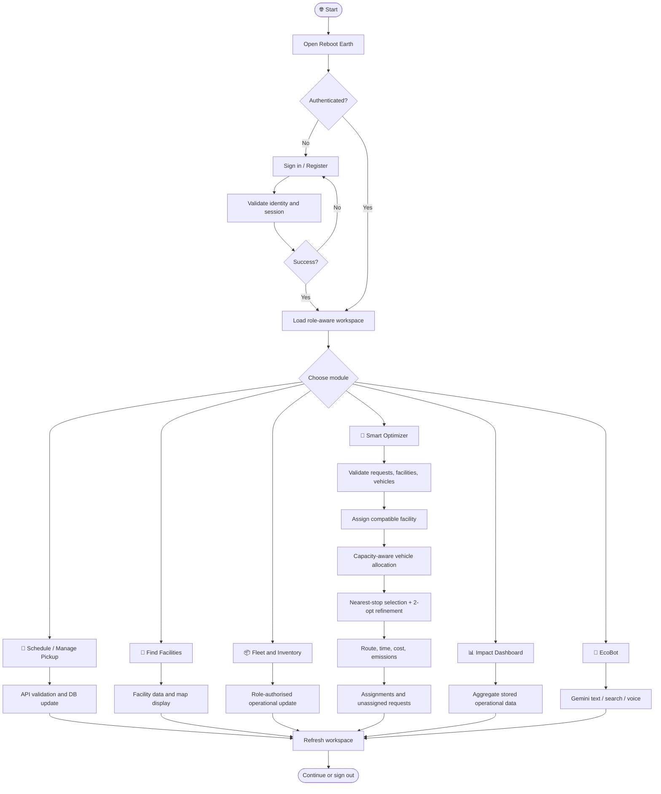
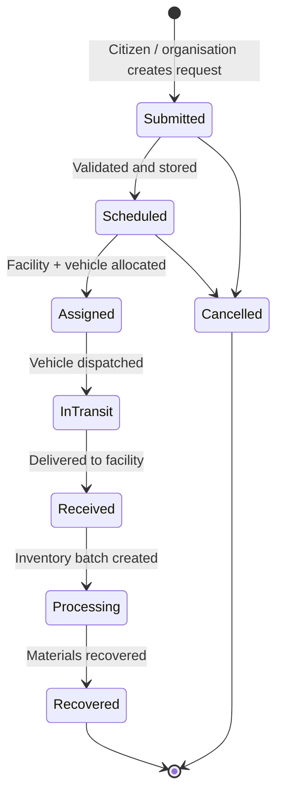
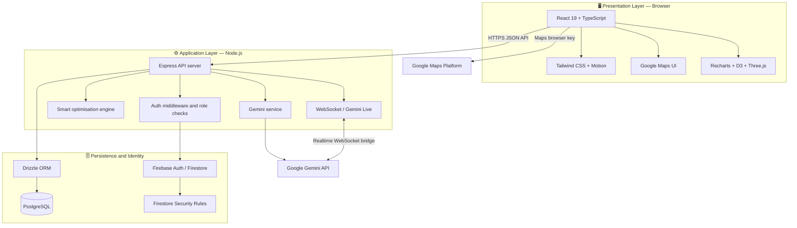
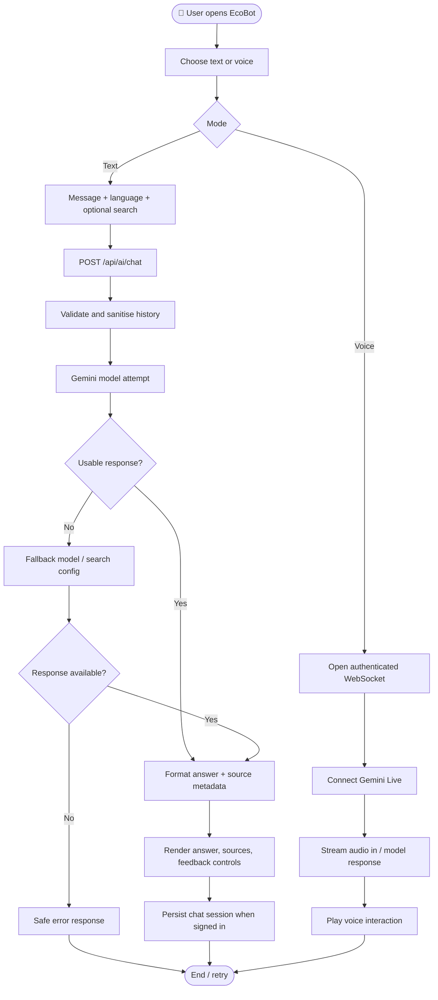
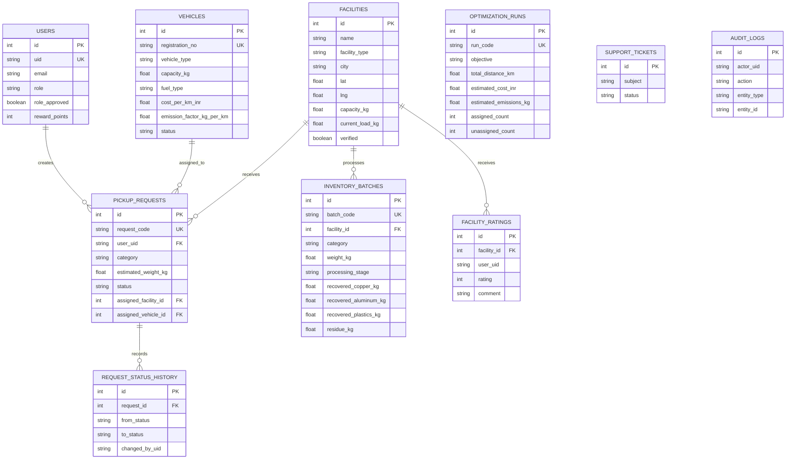
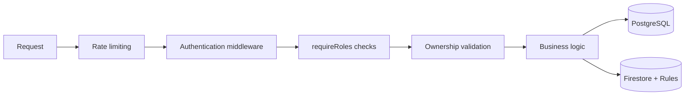
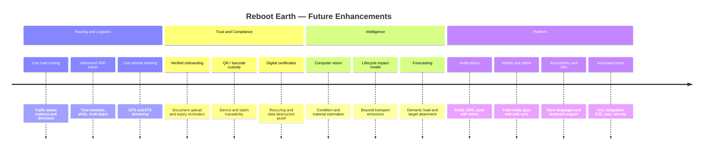

<div align="center">


<a href="https://git.io/typing-svg">
  
</a>

<br/>


**[Overview](#-overview) · [Features](#-key-features) · [Preview](#-interface-preview) · [Architecture](#-system-architecture) · [Optimiser](#-smart-optimiser-engine) · [EcoBot](#-ecobot-ai-assistant) · [Database](#-database-schema) · [Security](#-security-model) · [Quick Start](#-quick-start) · [Roadmap](#-roadmap)**

</div>

> [!NOTE]
> **Project status:** this README describes the implementation found in the repository. Some integrations need credentials and configured cloud services. Demo facility records and modelled environmental figures are **not** independently verified operational or scientific measurements.

---

## 🌍 Overview

**Reboot Earth** is a web-based e-waste management and circular-recovery platform. It connects **citizens, organisations, collection centres, recyclers, refurbishers, transporters and producers** through one coordinated digital workflow.

It combines doorstep pickup requests, facility discovery, fleet and inventory operations, route optimisation, environmental-impact analytics and an AI assistant called **EcoBot**. E-waste is modelled as a *recoverable resource stream* rather than a disposal problem: **collect safely → route intelligently → process responsibly → measure impact.**

<div align="center">

| 🧩 Modules | 🎭 User roles | 🎯 Optimiser objectives | 🗣️ EcoBot languages |
|:---:|:---:|:---:|:---:|
| **14** feature areas | **8** roles | **3** (distance · cost · emissions) | **3** (English · Hindi · Hinglish) |

</div>

### 🌱 Vision
A future where electronic waste is recovered as a valuable resource through accessible, transparent and intelligent recycling networks.

### 🎯 Mission
Make responsible e-waste management easier to access and operate by connecting people and organisations with suitable facilities, coordinated pickups, capacity-aware transport planning and actionable environmental insights.

### 💎 Core values

| ♻️ Circularity | 🧭 Accessibility | ⚡ Efficiency | 🔍 Transparency | 🛡️ Safety | 📜 Accountability |
|---|---|---|---|---|---|
| Reuse, refurbish, recover | Simple flows for everyday users | Consolidate pickups, reuse fleet | Visible status and history | Careful handling of hazardous parts, e.g. Li-ion | Role checks, ownership checks, audit records |

---

## 🚨 The Problem → ✅ The Solution

<table>
<tr>
<td width="50%" valign="top">

### 🚨 Operational gaps
1. People don't know where to take old electronics or how to book a safe pickup.
2. Collection networks are fragmented.
3. One vehicle per pickup wastes distance, cost and emissions.
4. Facilities lack visibility into categories, capacity and incoming material.
5. Users get little progress information after submitting a request.
6. Impact is hard to communicate without consistent data.
7. Battery-safety, data-wiping and rules guidance is scattered.

</td>
<td width="50%" valign="top">

### ✅ What Reboot Earth provides
- Facility discovery with accepted categories.
- Pickup requests with device, weight, address, location and time.
- Status tracking with full history.
- Fleet, capacity and inventory coordination.
- Optimiser for **min distance / min cost / min emissions**.
- Route assignments, unassigned reasons, utilisation and savings.
- **EcoBot** for guidance, regulation Q&A and voice.
- Analytics, monthly targets and impact indicators.

</td>
</tr>
</table>

---

## ✨ Key Features

| | Module | What it does |
|:--:|---|---|
| 🏠 | **Public experience** | Home, About/legal information, Knowledge Hub, facility discovery |
| 🔐 | **Authentication** | Firebase-backed identity plus a local account/session implementation |
| 🧭 | **Role-aware dashboard** | Workspace and navigation adapt to the signed-in role |
| 🚚 | **Pickup management** | Create, view, reschedule and track pickup requests |
| 📍 | **Facility discovery** | Search and map collection centres, recyclers and refurbishers |
| ✅ | **Verification and ratings** | Admin verification workflow and user facility feedback |
| 🚛 | **Fleet management** | Vehicle registration, availability/maintenance status, fleet attributes |
| 📦 | **Inventory management** | Received batches, processing stages, recovered materials |
| 🧠 | **Smart Optimizer** | Compare cost, distance and emissions; assign vehicles and stops |
| 📊 | **Impact dashboard** | Analytics summaries, trend charts, monthly recycling targets |
| 🤖 | **EcoBot** | Gemini text assistant, optional search grounding, regulation search, voice mode |
| 🎮 | **3D experience** | Interactive Three.js scenes and visual storytelling |
| 🎫 | **Support and administration** | Support tickets, role administration, audit-oriented records |
| 🔔 | **Notifications and preferences** | Firebase-backed notifications, chat sessions and preferences where configured |

---

## 🖼️ Interface Preview

> Screenshots are real captures of the application interface. Figures, facilities, ratings and statuses shown in them come from **demo/sample data** and are not independently verified operational or scientific measurements.

<div align="center">

| 🏠 Home | 📊 Impact Analytics | 📍 Find Centres |
|:---:|:---:|:---:|
| <a href="./docs/screenshots/01-home.png"></a> | <a href="./docs/screenshots/02-impact-dashboard.png"></a> | <a href="./docs/screenshots/03-find-centres.png"></a> |
| **🧠 Route Optimizer** | **🎮 3D Scenes Studio** | **🔐 Registration** |
| <a href="./docs/screenshots/04-optimizer.png"></a> | <a href="./docs/screenshots/05-3d-scenes.png"></a> | <a href="./docs/screenshots/06-registration.png"></a> |

<sub>Click any thumbnail for the full-size image.</sub>

</div>

### 1 · Home — landing page
The landing page presents Reboot Earth as an *intelligent e-waste logistics and recovery network*. The hero offers two primary journeys — **Schedule E-Waste Pickup** and **Find Collection Centres** — beside an interactive *Circular Planet Network* panel that switches between Orbital Globe, 3D Interactive Fleet and 3D Scenes Studio. The top navigation links Home, Find Centres, Optimizer, 3D Scenes, Knowledge Hub and About, with global search, a theme toggle and sign-in. Floating **Live Voice** and **Ask EcoBot** buttons give quick access to the AI assistant.

<div align="center">
  
</div>

### 2 · Impact analytics — network-wide totals
The impact section summarises recycled e-waste, CO₂e emissions saved and energy recovered as headline cards (with landfill-diversion rate, refurbished devices, verified-centre count and precious-metal figures), followed by a dual-axis **6-month trend chart** of e-waste collected (kg) against energy recovered (kWh). *The numbers in this capture are demo/sample values.*

<div align="center">
  
</div>

### 3 · Find verified collection centres
Facility search combines a text query, facility-type and waste-category filters and a **Search Google Maps** action with an interactive Google Map and facility cards. Each card shows facility type, verification status, operating hours, address, accepted categories, a **capacity-load bar** and a **Route** action; selecting a marker opens an info window with directions. Community ratings and reviews appear below. *Facilities shown are labelled "Demo Reference".*

<div align="center">
  
</div>

### 4 · Smart Multi-Objective Logistics Optimizer
The Optimizer Studio lets an operator choose **Min Emissions**, **Min Distance** or **Min Cost (₹)** and click **Run Optimization**. The result view shows KPI cards (optimised distance, estimated dispatch cost, transport emissions, estimated travel time, batch coverage with assigned/unassigned counts), a highlighted **route map** with per-vehicle route tabs and stops, per-route summaries, and a **CSV export**. *The run in this capture uses demo data; its savings are modelled against the optimiser's own separate-trip baseline, not an independent benchmark.*

<div align="center">
  
</div>

### 5 · Interactive 3D Scenes Studio
A Three.js scene of a **Smart Collection Hub & EV Fleet** — solar-powered sorting bay, twin recovery cyclones and an EV collection van. Click the facility or van to inspect, drag to orbit and scroll to zoom. Scene controls switch between **Eco Hub**, **Device Anatomy** and **Orbital Network**, with *Overview*, *Close-Up* and *Aerial* camera views, a daylight toggle, pause and reset.

<div align="center">
  
</div>

### 6 · Sign in and registration
A split-screen onboarding page: a role-based registration form (**Citizen**, **Collection centre**, **Recycler**, **Transporter**) with name, email and password fields, beside a workspace panel explaining the citizen journey — book a pickup slot, follow custody updates, and measure environmental impact.

<div align="center">
  
</div>

<details>
<summary><b>📂 Other workspaces and screenshot assets</b></summary>

| Screen | Purpose |
|---|---|
| Dashboard | Operational overview and role-specific modules |
| Pickup Manager / Schedule Pickup | Create and manage collection requests |
| EcoBot panel | Text or voice questions |
| Knowledge Hub | Learn about e-waste and responsible handling |

Screenshots live in the repository at:

```text
docs/
└── screenshots/
    ├── 01-home.png
    ├── 02-impact-dashboard.png
    ├── 03-find-centres.png
    ├── 04-optimizer.png
    ├── 05-3d-scenes.png
    └── 06-registration.png
```
</details>

---

## 🔄 How It Works



### 🔁 Pickup lifecycle


> The diagram above is an illustrative lifecycle. Exact status names and transitions are defined in the application code and enforced by the API.

---

## 🏗️ System Architecture



| Layer | Responsibility |
|---|---|
| **Presentation** | Public pages, role-aware workspaces, forms, maps, charts, 3D scenes, EcoBot UI |
| **Application** | `server.ts` hosts the Express API; middleware handles auth, optional auth, role checks and rate limits; logic lives in `optimizer.ts`, `gemini.ts`, `liveVoice.ts` |
| **Relational persistence** | Drizzle ORM maps typed schema to PostgreSQL: users, facilities, vehicles, pickups, inventory, optimisation runs, records |
| **Firebase services** | Auth plus selected Firestore data: profiles, preferences, notifications, chat sessions; guarded by Firestore rules |
| **External services** | Google Maps Platform (maps) and Google Gemini (text, grounded search, image, live voice) |

> [!IMPORTANT]
> The repository contains **both** PostgreSQL/Drizzle and Firebase/Firestore integrations serving different data paths. It is **not** MongoDB-, Flask- or Next.js-based.

---

## 🧰 Technology Stack

| Layer | Technologies |
|---|---|
| **Language** | TypeScript, JavaScript, CSS |
| **Frontend** | React 19, React DOM, Vite |
| **Styling / UI** | Tailwind CSS 4, Lucide React, Motion |
| **Maps** | `@vis.gl/react-google-maps`, Google Maps Platform |
| **Visualisation** | D3, Recharts, Three.js |
| **Backend** | Node.js, Express 4, TypeScript via `tsx` |
| **Relational DB** | PostgreSQL |
| **ORM / schema** | Drizzle ORM, Drizzle Kit |
| **Identity / documents** | Firebase, Firebase Admin, Firestore |
| **AI** | Google GenAI SDK / Gemini models |
| **Realtime** | `ws` WebSocket library, Gemini Live |
| **Build / quality** | Vite, TypeScript compiler, ESLint |
| **Package manager** | Bun lockfile included; npm scripts defined in `package.json` |

---

## 🧠 Smart Optimiser Engine

The optimiser groups pickups by compatible facility, packs loads within vehicle capacity, orders stops, and evaluates the chosen objective.

```mermaid
flowchart TD
    A([▶ Start optimisation]) --> B[Receive objective, requests, facilities, vehicles]
    B --> C[Exclude vehicles in Maintenance]
    C --> D[Init facility capacity, baseline, outputs]
    D --> E{More pickup requests?}
    E -- Yes --> F[Find category-compatible facilities]
    F --> G[Filter by remaining capacity]
    G --> H{Compatible facility?}
    H -- No --> I[Mark unassigned with reason]
    H -- Yes --> J[Rank by distance / cost consolidation]
    J --> K[Assign to facility bucket]
    I --> E
    K --> E
    E -- No --> L[Sort buckets by total weight]
    L --> M{Bucket has pickups left?}
    M -- No --> N[Aggregate KPIs and baseline]
    M -- Yes --> O[Evaluate feasible vehicles]
    O --> P[Greedy nearest-feasible packing]
    P --> Q[2-opt refinement]
    Q --> R[Route, time, cost, emissions, score]
    R --> S{Feasible candidate?}
    S -- No --> T[Mark oversized / unassignable]
    S -- Yes --> U[Choose lowest objective score]
    U --> V[Save assignment + continuation location]
    V --> W[Remove assigned requests]
    T --> M
    W --> M
    N --> X[Return routes, estimates, savings, reasons]
    X --> Y([■ End])
```



### 📐 Mathematical model

<details open>
<summary><b>Haversine distance</b></summary>

$$a=\sin^2\!\left(\tfrac{\Delta\phi}{2}\right)+\cos\phi_1\cos\phi_2\,\sin^2\!\left(\tfrac{\Delta\lambda}{2}\right),\qquad c=2\,\mathrm{atan2}\!\left(\sqrt{a},\sqrt{1-a}\right),\qquad d=R\,c$$

with $R = 6371$ km (mean Earth radius).
</details>

<details open>
<summary><b>Estimated road distance</b></summary>

$$D_{\text{road}} = D_{\text{Haversine}} \times 1.28$$

A modelled urban-circuity estimate, **not** a live road-routing distance from Google Maps Directions.
</details>

<details>
<summary><b>Travel time per leg</b></summary>

$$T_{\text{leg}}=\max\!\Big(1,\ \mathrm{round}\big(\tfrac{D_{\text{road}}}{V}\times 60 + T_{\text{dwell}}\big)\Big)$$

| Fuel | Speed assumption |
|---|---:|
| Electric | 29 km/h |
| CNG | 26 km/h |
| Diesel | 22 km/h |
| Unknown | 25 km/h |

Dwell: **8 min** per pickup (loading / manifest scan), **10 min** unloading at the facility.
</details>

<details>
<summary><b>Dispatch cost</b></summary>

$$C_{\text{route}} = D_{\text{route}}\times C_{\text{km}} + C_{\text{mobilisation}}$$

| Fuel | Mobilisation |
|---|---:|
| Electric | ₹240 |
| CNG | ₹260 |
| Diesel | ₹320 |
| Continuation shift | ₹0 |

`C_km` is the vehicle's configured `costPerKmInr`.
</details>

<details>
<summary><b>Transport emissions</b></summary>

$$E_{\text{route}} = D_{\text{route}}\times EF_{\text{km}} + E_{\text{cold-start}}$$

| Fuel | Factor (kg CO₂e/km) | Cold-start (kg) |
|---|---:|---:|
| Electric | 0.08 | 0 |
| CNG | 0.16 | 0.35 |
| Diesel | 0.29 | 1.45 |
| Continuation shift | — | no additional term |

These are application model parameters, **not** a certified lifecycle assessment. Electric is deliberately non-zero.
</details>

<details>
<summary><b>Utilisation, objective score, baseline and savings</b></summary>

$$U(\%)=\frac{\text{Assigned load (kg)}}{\text{Vehicle capacity (kg)}}\times 100$$

$$S_{\text{objective}}=\frac{\text{Route metric (distance, cost or emissions)}}{\max(1,\,N_{\text{covered}})}$$

$$\text{Saved}=\max(0,\ \text{Baseline}-\text{Optimised}),\qquad \text{Saved \%}=\frac{\text{Saved}}{\text{Baseline}}\times 100\ \ (\text{Baseline}>0)$$

The baseline models separate, unbatched round trips per request. It is clamped to at least the optimised value, so savings are never negative. This is a conservative *presentation*, not an independent benchmark.
</details>

### 🧪 Algorithms

| # | Algorithm | Purpose | Key idea |
|:-:|---|---|---|
| 1 | **Haversine distance** | Great-circle distance between two GPS points | Convert to radians → intermediate `a` → central angle `c` → `R·c` |
| 2 | **Compatible facility selection** | Pick a facility that accepts the category and has capacity | Filter by category and remaining capacity → rank by road distance → cost objective prefers already-active facilities |
| 3 | **Greedy capacity-aware packing** | Build a feasible load per vehicle | Repeatedly add the nearest request that still fits the payload |
| 4 | **2-opt refinement** | Improve stop order | Reverse segments; accept if gain > 0.05 km; up to 30 passes |
| 5 | **Candidate vehicle selection** | Choose vehicle per objective | Simulate each non-maintenance vehicle → score per covered pickup → pick lowest |
| 6 | **Baseline and KPI aggregation** | Quantify savings | Aggregate distance, time, cost, emissions vs separate-trip baseline |

### 🧱 Data structures in the optimiser

| Structure | Role |
|---|---|
| `facilityBuckets` (record by facility ID) | Groups compatible pickups per selected facility |
| `vehicleLocations` (`Map<number, location>`) | Remembers each vehicle's last facility for continuation shifts |
| `usedVehicleIds` (`Set<number>`) | Tracks vehicles mobilised in the current run |
| `remaining` (array) | Unassigned requests for the current bucket |
| `candidates` (array) | Vehicle simulations sorted by objective score |
| `assignments` / `unassigned` (arrays) | Successful allocations and explainable exceptions |

> [!WARNING]
> **Algorithmic limitations.** The optimiser is a deterministic *heuristic*, not an exact CVRP solver. It uses category/capacity filtering, greedy nearest-feasible selection, objective scoring and bounded 2-opt. It has no global-optimality proof, time-window solver, traffic-aware routing or MIP solver. Results depend on input coordinates, fleet parameters and the stated assumptions.

<details>
<summary><b>🧬 Other data structures and concepts used</b></summary>

| Concept | Use |
|---|---|
| Arrays | Pickup/facility/vehicle lists, ordered route stops, chat history, chart series |
| Objects / records | Typed entities, API payloads, configuration maps |
| Relational tables | PKs, unique constraints and foreign keys |
| Graph / network model | Route stops and depots as a weighted network; the code evaluates route sequences rather than using a graph library |
| State machines | Pickup statuses, vehicle availability, inventory stages |
| Interfaces and union types | Compile-time contracts for users, requests, vehicles, facilities, roles, objectives, chat messages |

The project is functional/component-oriented TypeScript, not class-heavy OOP. No custom linked list, stack, binary tree or heap is part of the inspected application logic.
</details>

---

## 🤖 EcoBot AI Assistant

EcoBot is a conversational assistant integrated into the app. The client sends the message, conversation history, language and a search preference to the server; the server sanitises the history and calls Gemini through the server-side SDK. Responses can include source links and a search-fallback indicator.



| Capability | Details |
|---|---|
| 🌐 **Languages** | English, Hindi, Hinglish |
| 📚 **Guidance** | E-waste and pickup workflows; India E-Waste (Management) Rules 2022 / EPR-oriented help |
| 🔎 **Grounding** | Facility-search grounding with source links |
| 📷 **Vision** | Device image identification and fast device triage |
| 🎨 **Generation** | Campaign image generation |
| 🎙️ **Voice** | Real-time channel over WebSockets and Gemini Live |
| 🛟 **Resilience** | Primary/fallback model paths; handles quota, access and transient errors |
| 🔑 **Key safety** | Gemini key stays on the server |

> [!CAUTION]
> AI output is informational and can be wrong or incomplete. It is not a substitute for official regulatory advice, certified hazardous-material handling instructions or professional inspection.

---

## 🗄️ Database Schema

Relational schema in `src/db/schema.ts` (Drizzle ORM → PostgreSQL).



<details>
<summary><b>📖 Table catalogue</b></summary>

| Table | Purpose |
|---|---|
| `users` | Identity mapping, role, approval state, organisation/contact details, reward points |
| `facilities` | Type, address, GPS, accepted categories, capacity, load, verification, contact |
| `vehicles` | Registration, vehicle/driver details, payload, fuel, cost/emission factors, base coordinates, status |
| `pickup_requests` | Owner, device, category, weight, coordinates, preferred date/time, status, optional facility/vehicle |
| `request_status_history` | Chronological transitions and actor notes |
| `inventory_batches` | Intake, processing stage, recovered materials, reusable units, residue |
| `optimization_runs` | Objective, baseline/optimised KPIs, assignments JSON, assumptions, approval state |
| `support_tickets` | User support requests and status |
| `audit_logs` | Actor, action, entity, details |
| `facility_ratings` | Feedback author, rating, comment |

**Firebase/Firestore** additionally holds user profiles, preferences, notifications, chat sessions, facility reviews, scheduled pickup bookings, optimisation records, inventory batches and support tickets. These are separate from the Drizzle tables; configure whichever data services your deployment uses.
</details>

---

## 👥 User Roles and Access

| Role | Responsibility |
|---|---|
| 🧑 `citizen` | Submit and track personal pickups; discover facilities |
| 🏢 `organization` | Coordinate e-waste from an organisation |
| 🏭 `collection_centre` | Manage collection operations and facility workflows |
| ♻️ `recycler` | Recycling-side processing and material recovery |
| 🔧 `refurbisher` | Repair, refurbishment and reuse |
| 🚛 `transporter` | Vehicles and pickup logistics |
| 🏷️ `producer` | Producer / EPR-oriented workflows |
| 🛡️ `admin` | Users, role approvals, verification, administration |

Role middleware guards sensitive routes (e.g. admin-only facility verification and role administration; transporter / collection-centre / admin limits on vehicle and optimisation actions). Permissions are endpoint-specific; do not assume every role can reach every module.

---

## 🔒 Security Model



<table>
<tr>
<td width="50%" valign="top">

**API and application**
- Authentication middleware on private endpoints
- `requireRoles(...)` for privileged operations
- Optional auth only on public/signed-in hybrid routes
- Rate limits on support, auth, optimisation and AI endpoints
- Gemini key read server-side from `GEMINI_API_KEY`
- Local auth: **scrypt** password hashing, **HMAC-SHA256** session tokens, 24 h expiry
- `AUTH_SESSION_SECRET` for session signing; without it a process-local random secret is generated (sessions reset on restart; unsuitable for multi-instance production)

</td>
<td width="50%" valign="top">

**Firestore rules** (`firestore.rules`, `security_spec.md`)
- Signed-in and verified-user checks
- Owner-scoped reads and writes
- Admin checks for privileged actions
- Exact key allow-lists (`hasAll` / `hasOnly`) against shadow-field injection
- Type, enum, string-length and array-size validation
- Server-time validation; immutable ownership/creation fields
- Validated document IDs
- Terminal-state protection for completed/cancelled pickups
- Restricted reviews with admin moderation

</td>
</tr>
</table>

<details>
<summary><b>✅ Pre-deployment security checklist</b></summary>

1. Replace all demo credentials; configure strong, persistent secrets.
2. Never commit `.env`, service-account keys or tokens.
3. Restrict Maps browser keys by HTTP referrer and enabled APIs.
4. Restrict server API keys by API and environment.
5. Use HTTPS everywhere.
6. Review CORS, cookies/session, proxy trust and rate-limit configuration.
7. Verify ownership and role checks on every route.
8. Test Firestore rules with the Firebase Emulator, including negative cases.
9. Use least-privilege DB credentials and managed backups.
10. Minimise stored personal data; protect addresses, phone numbers and precise coordinates.
11. Rotate exposed secrets immediately.
12. Treat AI output as untrusted; validate and escape before rendering.
</details>

> [!NOTE]
> This repository contains security controls, but a code review is not a penetration test or a guarantee of production security. Validate the deployed configuration independently.

---

## 🚀 Quick Start

### Prerequisites
- Node.js compatible with the Vite version in `package.json`
- npm (or Bun; `bun.lock` is included)
- PostgreSQL database and credentials
- Firebase project configuration (for Firebase-backed paths)
- Gemini API key and Google Maps API key

### 1 · Get the source
```bash
git clone https://github.com/raunakcse25-star/<YOUR_REPOSITORY_NAME>.git
cd <YOUR_REPOSITORY_NAME>
```

### 2 · Install dependencies
```bash
npm install      # or: bun install   (use one package manager consistently)
```

### 3 · Configure environment
```bash
cp .env.example .env            # macOS / Linux
# Copy-Item .env.example .env   # Windows PowerShell
```

| Variable | Purpose | Needed for |
|---|---|---|
| `GEMINI_API_KEY` | Server-side Gemini access | EcoBot, AI search, image/triage, voice |
| `APP_URL` | Hosted application URL | Deployment |
| `VITE_GOOGLE_MAPS_API_KEY` | Browser-side Maps key | Map features |
| `SQL_HOST` · `SQL_DB_NAME` | PostgreSQL host and database | PostgreSQL runtime |
| `SQL_USER` · `SQL_PASSWORD` | Application DB credentials | PostgreSQL runtime |
| `SQL_ADMIN_USER` · `SQL_ADMIN_PASSWORD` | Admin DB credentials | Provisioning tasks |
| `AUTH_SESSION_SECRET` | HMAC secret for local sessions | Recommended for local auth |

```dotenv
GEMINI_API_KEY=replace_with_server_side_gemini_key
APP_URL=http://localhost:3000
VITE_GOOGLE_MAPS_API_KEY=replace_with_restricted_browser_maps_key

SQL_HOST=localhost
SQL_DB_NAME=reboot_earth
SQL_USER=reboot_app
SQL_PASSWORD=replace_with_strong_password
SQL_ADMIN_USER=postgres
SQL_ADMIN_PASSWORD=replace_with_admin_password

AUTH_SESSION_SECRET=replace_with_a_long_random_secret
```

> [!WARNING]
> Never use example values in production, and keep server secrets out of `VITE_` variables, since Vite exposes them to browser bundles. Firebase client config is read by `src/lib/firebase.ts`; never put service-account credentials in frontend variables.

### 4 · Prepare PostgreSQL
1. Create a database and a least-privilege application user.
2. Fill in the `SQL_*` variables.
3. Inspect `src/db/drizzle.config.ts` and `src/db/index.ts` for the exact connection and migration setup.
4. Apply the schema using **one** strategy:

```bash
# Migration workflow
npx drizzle-kit generate
npx drizzle-kit migrate

# …or push-based development workflow
npx drizzle-kit push
```
Don't run both strategies against the same environment.

### 5 · Configure Firebase *(if using Firebase-backed features)*
Enable the authentication providers you use, set the client config in `src/lib/firebase.ts`, provide Admin credentials server-side if required, deploy the supplied Firestore rules and verify allowed/denied access in the Firebase Emulator.

### 6 · Run
```bash
npm run dev
```
`dev` runs `tsx server.ts`; the Express server also serves the Vite app. Open the URL printed in the terminal.

### 7 · Type-check, build and preview
```bash
npm run lint
npm run build
npm run preview
```
`lint` runs `tsc --noEmit` (a type-check, not full ESLint). The `start` script is `node server.ts`; confirm your production Node runtime supports a TypeScript entrypoint, or deploy a compiled JavaScript artifact.

### 🧾 Command reference

| Command | Purpose |
|---|---|
| `npm install` | Install dependencies |
| `npm run dev` | Start Express + Vite development server |
| `npm run build` | Build the frontend with Vite |
| `npm run preview` | Preview the built frontend |
| `npm run lint` | TypeScript compiler checks |
| `npm run lint:rules` | ESLint against Firestore rules |
| `npm run clean` | Remove `dist` and `server.js` (Unix-like shells) |

---

## 📁 Project Structure

```text
reboot-earth/
├── public/assets/aistudio/        # Static visual assets
├── src/
│   ├── assets/images/             # Project imagery
│   ├── components/
│   │   ├── ui/                    # Reusable UI primitives
│   │   ├── three/                 # Three.js scenes, models, textures
│   │   ├── AuthPage.tsx           # Authentication interface
│   │   ├── DashboardShell.tsx     # Role-aware application shell
│   │   ├── EcoBotWidget.tsx       # AI chat widget
│   │   ├── LiveVoicePanel.tsx     # Live voice UI
│   │   ├── FacilityMap.tsx        # Facility map experience
│   │   ├── OptimizerStudio.tsx    # Optimisation interface
│   │   ├── PickupManager.tsx      # Pickup operations
│   │   ├── SchedulePickup.tsx     # Pickup scheduling
│   │   ├── ImpactDashboard.tsx    # Impact analytics
│   │   ├── D3ImpactVisualizer.tsx
│   │   ├── MonthlyTargetsPanel.tsx
│   │   └── ...                    # Additional feature components
│   ├── context/AuthContext.tsx    # Shared auth and user state
│   ├── db/
│   │   ├── schema.ts              # Drizzle schema and relations
│   │   ├── queries.ts             # Query functions
│   │   ├── index.ts               # DB connection
│   │   └── drizzle.config.ts      # Drizzle configuration
│   ├── lib/
│   │   ├── api.ts                 # Typed fetch helper, local token handling
│   │   ├── firebase.ts            # Firebase client
│   │   ├── firebase-admin.ts      # Firebase Admin
│   │   ├── workspace.ts           # Workspace utilities
│   │   └── utils.ts               # Shared utilities
│   ├── middleware/auth.ts         # API authentication middleware
│   ├── server/
│   │   ├── optimizer.ts           # Route and fleet optimisation
│   │   ├── gemini.ts              # Gemini text, search, image
│   │   ├── liveVoice.ts           # WebSocket / Gemini Live bridge
│   │   └── localAuth.ts           # Password hashing and signed sessions
│   ├── App.tsx                    # Main React app and navigation
│   ├── main.tsx                   # Client entry point
│   ├── types.ts                   # Shared TypeScript contracts
│   └── index.css                  # Global styles
├── .env.example                   # Environment template
├── firestore.rules                # Firestore access control
├── security_spec.md               # Security invariants and threat cases
├── server.ts                      # Express API and server entry
├── package.json                   # Scripts and dependencies
├── vite.config.ts                 # Vite configuration
├── tsconfig.json                  # TypeScript configuration
└── README.md
```
*Abbreviated; see the repository for the full component inventory.*

---

## 📊 Quantitative Evaluation

### Metrics the optimiser reports per run

| Metric | Unit | Meaning |
|---|:-:|---|
| Total route distance | km | Sum of assigned vehicle route distances |
| Baseline distance / saved | km, % | Modelled separate-trip baseline vs optimised |
| Estimated travel time / saved | min, % | Leg travel plus pickup/unload dwell |
| Estimated transport cost / saved | ₹, % | Variable cost plus mobilisation |
| Estimated emissions / saved | kg CO₂e, % | Distance factor plus cold-start |
| Assigned / unassigned | count | Coverage and exceptions |
| Vehicle utilisation | % | Assigned load ÷ payload capacity |

### Reproducible evaluation protocol
The repository ships **no** benchmark dataset or measured before/after results, so **no numeric performance improvement is claimed**. To produce defensible numbers:

1. Fix a dataset of pickups (coordinates, categories, weights).
2. Define facilities (categories, GPS, load, capacity) and a fleet (payload, fuel, cost/km, emission factor, availability).
3. Run all three objectives on the same input snapshot.
4. Record distance, time, cost, emissions, assignments and unassigned reasons.
5. Compare with the modelled baseline and validate sample routes against a real routing service.
6. Repeat for small, medium and large datasets; record runtime and coverage.
7. Publish assumptions, run date, configuration and raw outputs.

| Test case | Requests | Facilities | Vehicles | Objective | Assigned | Unassigned | Distance (km) | Cost (₹) | Emissions (kg CO₂e) | Runtime (ms) |
|---|--:|--:|--:|---|--:|--:|--:|--:|--:|--:|
| Small | — | — | — | Distance | — | — | — | — | — | — |
| Medium | — | — | — | Cost | — | — | — | — | — | — |
| Large | — | — | — | Emission | — | — | — | — | — | — |

*Fill from actual runs only; do not replace dashes with invented values.*

### 🧪 Recommended test coverage

| Area | Checks |
|---|---|
| Authentication | Valid login, invalid password, expired token, role restrictions |
| Ownership | A user cannot view, modify or cancel another user's pickup |
| Pickup workflow | Valid/invalid creation, rescheduling, legal status transitions |
| Facility matching | Accepted/rejected category, capacity available/exhausted |
| Fleet allocation | Unavailable or maintenance vehicle, request heavier than any vehicle, multi-request packing |
| Optimiser | All three objectives on identical data; 2-opt never worsens distance on accepted swaps |
| AI | Missing key, quota error, empty response, fallback, malformed history |
| Firestore | Allowed and denied cases from `security_spec.md` |
| Build | `npm run lint` and `npm run build` |

---

## ⚠️ Assumptions and Limitations

- Road distance uses Haversine × 1.28, not a traffic-aware path.
- Speeds, cost/km, emission factors, dispatch costs and dwell times are model inputs.
- The optimiser is heuristic and does not guarantee global optimality.
- Facility verification depends on the deployment's process; seeded/demo records may be illustrative.
- AI answers can be inaccurate and should be reviewed.
- Maps, Firebase and Gemini features need valid configuration, API access and quota.
- Both PostgreSQL and Firebase integrations exist; operators must configure the ones their workflows use.
- No measured benchmarks are included; performance claims need repeatable tests.

---

## 🗺️ Roadmap



- [ ] Live, traffic-aware road routing
- [ ] Time-window / multi-depot VRP solver with solver comparison
- [ ] Live vehicle tracking and ETAs
- [ ] Verified facility onboarding workflow
- [ ] QR / barcode chain of custody
- [ ] Auditable recycling and data-destruction certificates
- [ ] Computer-vision device classification
- [ ] Lifecycle (not just transport) impact model
- [ ] Reliable email / SMS / push notifications
- [ ] Mobile app and offline-first field operations
- [ ] Demand and throughput forecasting
- [ ] Broader accessibility and localisation
- [ ] Full automated test suites

---

## 📚 References

<details>
<summary><b>Policy, technical documentation and algorithms</b></summary>

**E-waste policy and compliance** *(verify the latest Gazette notifications before relying on compliance statements)*
- [CPCB, India](https://cpcb.nic.in/) · [MoEFCC](https://moef.gov.in/) · [India Code](https://www.indiacode.nic.in/)

**Technical documentation**
[React](https://react.dev/) · [TypeScript](https://www.typescriptlang.org/docs/) · [Vite](https://vite.dev/guide/) · [Node.js](https://nodejs.org/docs/) · [Express](https://expressjs.com/) · [PostgreSQL](https://www.postgresql.org/docs/) · [Drizzle ORM](https://orm.drizzle.team/docs/overview) · [Firebase](https://firebase.google.com/docs) · [Firestore Rules](https://firebase.google.com/docs/firestore/security/get-started) · [Google Maps Platform](https://developers.google.com/maps/documentation) · [Gemini API](https://ai.google.dev/gemini-api/docs) · [Three.js](https://threejs.org/docs/) · [D3](https://d3js.org/) · [Recharts](https://recharts.org/)

**Algorithms**
- Haversine: spherical great-circle distance approximation.
- 2-opt: local-search heuristic for TSP-style tours.
- Payload-constrained routing is a variant of the Capacitated Vehicle Routing Problem (CVRP).

Cite exact rule versions, model versions, emission-factor sources and datasets when publishing formal results.
</details>

---

## 🤝 Contributing

1. Fork the repository.
2. Create a focused branch: `git checkout -b feature/your-feature`.
3. Follow the existing TypeScript/component patterns and keep changes scoped.
4. Add or update tests for behaviour changes.
5. Never commit `.env`, credentials, service-account files or personal data.
6. Run `npm run lint` and `npm run build`.
7. Re-test role permissions and ownership boundaries when touching API or data access.
8. Update docs, environment examples and screenshots when behaviour changes.
9. Open a pull request describing the problem, solution, test evidence and any migration/configuration impact.

```text
feat: add pickup status notification
fix: prevent over-capacity vehicle assignment
docs: clarify local development setup
security: restrict facility verification endpoint
test: cover optimiser capacity edge cases
```

---

## 👤 Author

<div align="center">

<a href="https://github.com/raunakcse25-star">
  
</a>

### **raunakcse25-star**
*Creator and maintainer · Team RebootEarth*

[](https://github.com/raunakcse25-star)

</div>

### 🤝 Contributors

<div align="center">
<table>
  <tr>
    <td align="center" width="180">
      <a href="https://github.com/raunakcse25-star">
        <br/>
        <sub><b>raunakcse25-star</b></sub>
      </a><br/>
      <sub>Author · Project lead</sub>
    </td>
    <td align="center" width="180">
      <a href="https://github.com/AnishaDubey-022329">
        <br/>
        <sub><b>AnishaDubey-022329</b></sub>
      </a><br/>
      <sub>Collaborator</sub>
    </td>
    <td align="center" width="180">
      <a href="https://github.com/nidhimishra-04">
        <br/>
        <sub><b>Nidhi Mishra</b></sub>
      </a><br/>
      <sub>Collaborator</sub>
    </td>
    <td align="center" width="180">
      <a href="https://github.com/sumit23-bot">
        <br/>
        <sub><b>Sumit Arya</b></sub>
      </a><br/>
      <sub>Collaborator</sub>
    </td>
    <td align="center" width="180">
      <a href="https://github.com/Sushant9871">
        <br/>
        <sub><b>Sushant9871</b></sub>
      </a><br/>
      <sub>Collaborator</sub>
    </td>
  </tr>
</table>
</div>

| Contributor | GitHub | Access | Contribution |
|---|---|---|---|
| **Raunak Kumar** | [@raunakcse25-star](https://github.com/raunakcse25-star) | Owner | Overall project, architecture and implementation |
| **Anisha Dubey** | [@AnishaDubey-022329](https://github.com/AnishaDubey-022329) | Collaborator | *Add verified contribution* |
| **Nidhi Mishra** | [@nidhimishra-04](https://github.com/nidhimishra-04) | Collaborator | *Add verified contribution* |
| **Sumit Arya** | [@sumit23-bot](https://github.com/sumit23-bot) | Collaborator | *Add verified contribution* |
| **Sushant** | [@Sushant9871](https://github.com/Sushant9871) | Collaborator | *Add verified contribution* |

---

## 📄 License

No explicit `LICENSE` file or licence declaration is present. Until the owners add one, **all rights remain with the respective copyright holders** and reuse, redistribution or modification should not be assumed permitted. To open-source the project, choose a licence, add its full text as a root-level `LICENSE` file and update this section.

---

<div align="center">

### 🌍♻️ *Collect smarter. Recover responsibly. Reboot Earth.*

Every device collected responsibly is a chance to recover materials, extend product life and prevent avoidable waste.

**If this project inspires you, consider giving it a ⭐**


<sub>Built with purpose by <a href="https://github.com/raunakcse25-star">raunakcse25-star</a> · Technology for a cleaner, more circular tomorrow.</sub>

</div>
