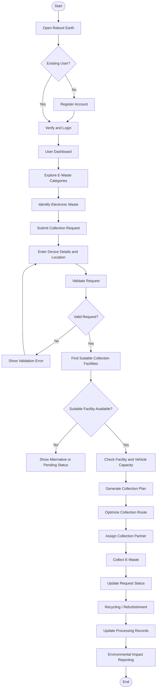
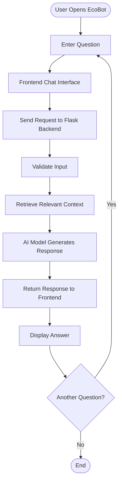
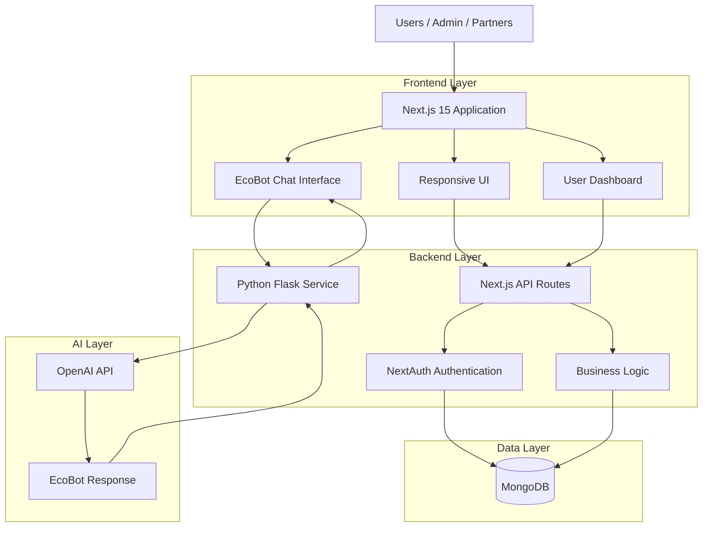

# 🌍 Reboot Earth
### Recycle Technology. Restart Tomorrow.

<p align="center">
  <strong>An Intelligent E-Waste Management & Optimization Platform</strong>
</p>

<p align="center">
  A smarter digital ecosystem for responsible electronic waste collection, recycling, facility management and sustainable resource recovery.
</p>

<p align="center">
  
  
  
  
</p>

---

## 📌 Table of Contents

- [1. About the Project](#-1-about-the-project)
- [2. The Problem](#-2-the-problem)
- [3. Our Solution](#-3-our-solution)
- [4. Project Objectives](#-4-project-objectives)
- [5. Key Features](#-5-key-features)
- [6. How Reboot Earth Works](#-6-how-reboot-earth-works)
- [7. System Flowchart](#-7-system-flowchart)
- [8. System Architecture](#-8-system-architecture)
- [9. Technology Stack](#-9-technology-stack)
- [10. Project Structure](#-10-project-structure)
- [11. Installation and Setup](#-11-installation-and-setup)
- [12. Environment Variables](#-12-environment-variables)
- [13. Running the Project](#-13-running-the-project)
- [14. User Roles](#-14-user-roles)
- [15. Security Implementation](#-15-security-implementation)
- [16. Future Enhancements](#-16-future-enhancements)
- [17. Environmental Impact](#-17-environmental-impact)
- [18. Research and References](#-18-research-and-references)
- [19. Team Reboot Earth](#-19-team-reboot-earth)
- [20. Contribution Guidelines](#-20-contribution-guidelines)
- [21. License](#-21-license)

---

## 🌱 1. About the Project

**Reboot Earth** is an intelligent E-Waste Management and Optimization Platform designed to make electronic waste disposal more accessible, organized, transparent and environmentally responsible.

With the rapid growth of technology, electronic devices are replaced more frequently than ever. Smartphones, laptops, batteries, computers, televisions and other electronic products eventually become electronic waste.

Improper disposal of these products can release hazardous substances, contaminate the environment and waste valuable recoverable materials.

Reboot Earth aims to address this challenge through a centralized digital platform that connects individuals, institutions, collection centres, recyclers and transportation partners.

The platform combines modern web technologies, database management, artificial intelligence and optimization concepts to support a more organized e-waste management ecosystem.

### 🎯 Our Vision

To build a technology-driven ecosystem where every electronic device gets an opportunity for responsible collection, reuse, refurbishment or recycling.

### 💡 Our Mission

- Promote responsible e-waste disposal.
- Connect users with appropriate collection and recycling channels.
- Improve coordination between e-waste stakeholders.
- Encourage reuse and recovery of electronic resources.
- Make environmental awareness accessible through technology.
- Support efficient collection and transportation planning.

---

## ⚠️ 2. The Problem

Electronic waste is one of the fastest-growing waste streams worldwide.

Some major challenges include:

- **Improper Disposal:** Electronic devices are frequently discarded with ordinary household waste.
- **Lack of Awareness:** Many people do not know how or where to dispose of unwanted electronic products safely.
- **Fragmented Collection Systems:** Information about collection centres and recycling facilities can be difficult to find.
- **Transportation Inefficiency:** Poorly coordinated collection routes can increase transportation time and costs.
- **Limited Traceability:** Users may have little visibility into what happens after their electronic waste is collected.
- **Resource Loss:** Valuable materials that could be recovered through recycling and refurbishment may be wasted.

According to the *Global E-waste Monitor 2024*, approximately 62 million tonnes of e-waste were generated worldwide in 2022, while only 22.3% was documented as formally collected and recycled.

**This highlights the need for smarter, more accessible and coordinated e-waste management solutions.**

---

## 💚 3. Our Solution

Reboot Earth provides a centralized platform that brings different e-waste management activities together.

The proposed ecosystem includes:

1. **User Registration:** Users can create accounts and securely access the platform.
2. **E-Waste Identification:** Users can explore electronic waste categories and learn about responsible disposal.
3. **Collection Requests:** Users can submit requests with device information, quantities and pickup locations.
4. **Facility Matching:** The platform can identify suitable collection facilities based on location, accepted waste categories and capacity.
5. **Route Optimization:** A planned optimization module can help determine efficient collection routes.
6. **Request Tracking:** Users and authorized partners can monitor collection progress.
7. **AI Assistance:** EcoBot provides website guidance and e-waste management information.
8. **Environmental Analytics:** The platform can present collection statistics and estimated environmental impact.

Our goal is to make responsible e-waste management simpler for individuals and more organized for operational partners.

---

## 🚀 4. Project Objectives

| Objective | Description |
|---|---|
| Digital Accessibility | Make e-waste information and collection workflows accessible online. |
| Responsible Disposal | Encourage appropriate collection, reuse and recycling. |
| Smart Coordination | Connect users, facilities and recycling partners. |
| Optimization | Support efficient collection and transportation planning. |
| Transparency | Maintain structured collection and processing records. |
| Environmental Awareness | Educate users about e-waste and sustainable practices. |
| Security | Protect user accounts and application data. |

---

## ✨ 5. Key Features

### 👤 A. User Management and Authentication

- User registration and login.
- Secure password storage.
- Forgot password and password reset workflow.
- Session management.
- User profile management.
- Role-based access control.
- Protected user dashboards.

### ♻️ B. E-Waste Management

- Explore different e-waste categories.
- Access information about electronic waste.
- Learn about safe handling and disposal.
- Submit electronic waste collection requests.
- Provide device details and quantities.
- Maintain request history.

### 📍 C. Collection and Facility Management

- Collection request management.
- Collection facility information.
- Accepted waste category management.
- Facility capacity information.
- Pickup location management.
- Request status updates.

### 🧠 D. Intelligent Optimization

The planned optimization component aims to consider:

- Collection location.
- Distance between locations.
- Facility acceptance criteria.
- Available facility capacity.
- Vehicle capacity.
- Estimated transportation cost.
- Estimated transportation emissions.

The objective is to recommend feasible and efficient collection arrangements.

### 🤖 E. EcoBot – AI-Powered Assistant

**EcoBot — Your Intelligent E-Waste Management Assistant**

EcoBot is designed to help users understand the platform and learn about responsible electronic waste management.

It aims to provide:

- Answers to website-related questions.
- E-waste identification guidance.
- Recycling and disposal information.
- Safe handling recommendations.
- Environmental awareness information.
- English, Hindi and Hinglish communication support.

### 📊 F. Dashboard and Analytics

- User activity overview.
- Collection request statistics.
- E-waste category summaries.
- Collection and processing records.
- Environmental impact estimates.
- Administrative monitoring.

### 🎨 G. User Experience

- Modern responsive interface.
- Dark and light theme support.
- Smooth animations and transitions.
- Mobile, tablet and desktop compatibility.
- Interactive navigation.
- Accessible user interface.
- Clear loading, success and error states.

### 🔐 H. Security and Privacy

- Secure authentication.
- Password hashing.
- Protected API endpoints.
- Server-side validation.
- Role-based permissions.
- Environment-based secret management.
- Rate limiting for sensitive endpoints.

**Note:** The availability of individual features depends on their implementation and integration in the current project build.

---

## 🔄 6. How Reboot Earth Works

The platform follows a structured process:

**Step 1 — Register:** Create an account and log in.

**Step 2 — Identify:** Explore e-waste categories and identify unwanted electronic products.

**Step 3 — Submit:** Provide device information, quantity and collection location.

**Step 4 — Match:** Identify suitable facilities based on accepted materials and capacity.

**Step 5 — Optimize:** Evaluate feasible collection and transportation arrangements.

**Step 6 — Collect:** Authorized partners update collection progress.

**Step 7 — Process:** Record recycling, refurbishment or other processing updates.

**Step 8 — Analyze:** Present collection information and environmental impact estimates.

---

## 📊 7. System Flowchart

The following flowchart illustrates the proposed end-to-end workflow of Reboot Earth.



### EcoBot AI Assistant Flow



---

## 🏗️ 8. System Architecture

Reboot Earth follows a modular architecture in which the frontend, backend, database and AI assistant communicate through controlled APIs.



### Architecture Explanation

| Layer | Responsibility |
|---|---|
| Frontend | Displays pages, forms, dashboards and chat interface. |
| Backend | Handles application logic and API requests. |
| Authentication | Manages user identity and sessions. |
| Database | Stores application and user-related records. |
| AI Service | Processes chatbot requests and generates responses. |
| Optimization | Supports facility matching and route planning. |

---

## 💻 9. Technology Stack

### Frontend

- **Next.js 15** — React-based web application framework.
- **JavaScript** — Application programming logic.
- **HTML5** — Web page structure.
- **CSS3** — Styling and responsive layouts.

### Backend

- **Next.js API Routes** — Application API endpoints.
- **Python** — AI service and supporting logic.
- **Flask** — Lightweight Python backend framework.

### Database

- **MongoDB** — NoSQL database for application data.

### Authentication

- **NextAuth.js** — Authentication and session management.
- **bcryptjs** — Password hashing.

### Artificial Intelligence

- **OpenAI API** — AI-powered response generation.
- **EcoBot** — E-waste and platform assistance.

### Planned Integrations

- Mapping and geolocation services.
- Route optimization algorithms.
- Environmental analytics and reporting.

---

## 📁 10. Project Structure

The following is an illustrative structure. Adapt it to match the actual folders and files in your repository.

```text
REBOOT-EARTH/
│
├── public/
│   ├── images/
│   ├── icons/
│   └── assets/
│
├── src/
│   ├── app/
│   │   ├── page.js
│   │   ├── layout.js
│   │   ├── globals.css
│   │   │
│   │   ├── auth/
│   │   │   ├── signin/
│   │   │   ├── signup/
│   │   │   └── forgot-password/
│   │   │
│   │   ├── dashboard/
│   │   ├── admin/
│   │   ├── collection/
│   │   ├── recycling/
│   │   │
│   │   └── api/
│   │       └── auth/
│   │
│   ├── components/
│   │   ├── Navbar/
│   │   ├── Footer/
│   │   ├── Dashboard/
│   │   ├── Chatbot/
│   │   └── UI/
│   │
│   ├── lib/
│   │   ├── mongodb.js
│   │   └── auth.js
│   │
│   └── styles/
│
├── chatbot-backend/
│   ├── app.py
│   ├── requirements.txt
│   └── .env
│
├── .env.local
├── .gitignore
├── package.json
├── package-lock.json
└── README.md
```

---

## ⚙️ 11. Installation and Setup

Follow these steps to run Reboot Earth locally.

### Prerequisites

Install the following software before starting:

| Software | Purpose |
|---|---|
| Node.js | Run the Next.js application |
| npm | Install JavaScript dependencies |
| Python 3 | Run the Flask service |
| MongoDB | Store application data |
| Git | Version control |
| Visual Studio Code | Development environment |

### Step 1: Clone the Repository

Open your terminal or Git Bash.

```bash
git clone https://github.com/YOUR-USERNAME/REBOOT-EARTH.git
```

Navigate into the project directory:

```bash
cd REBOOT-EARTH
```

### Step 2: Open in Visual Studio Code

```bash
code .
```

### Step 3: Install Frontend Dependencies

```bash
npm install
```

### Step 4: Configure Environment Variables

Create a `.env.local` file in the root directory.

Add the required configuration values as described in Section 12.

### Step 5: Configure the Python Backend

Navigate to the chatbot backend:

```bash
cd chatbot-backend
```

Create a virtual environment:

```bash
python -m venv venv
```

Activate it on Windows:

```bash
venv\Scripts\activate
```

Install Python dependencies:

```bash
pip install -r requirements.txt
```

Configure the backend environment variables in its `.env` file.

### Step 6: Start the Flask Backend

```bash
python app.py
```

Use the host and port configured in your Flask application.

### Step 7: Start the Next.js Application

Open another terminal in the root project directory:

```bash
npm run dev
```

### Step 8: Open the Website

Visit:

```text
http://localhost:3000
```

Your local development server should now be running.

---

## 🔑 12. Environment Variables

Create a `.env.local` file in the project root.

Example:

```env
# MongoDB Configuration
MONGODB_URI=your_mongodb_connection_string
DATABASE_NAME=your_database_name

# Authentication
NEXTAUTH_SECRET=your_secure_random_secret
NEXTAUTH_URL=http://localhost:3000

# AI Integration
OPENAI_API_KEY=your_openai_api_key

# Chatbot Backend
FLASK_API_URL=http://localhost:5000
```

For the Flask backend, create a separate `.env` file if your backend loads its own configuration.

```env
OPENAI_API_KEY=your_openai_api_key
```

### Important Security Instructions

- Never upload `.env.local` or backend `.env` files to GitHub.
- Never expose private API keys in frontend code.
- Never use `NEXT_PUBLIC_` for private API secrets.
- Use strong, unique authentication secrets.
- Restrict database credentials and external API access.
- Rotate any API key that has been accidentally exposed.

**Important:** Replace example values with your own configuration. Variable names and service URLs must match the actual application code.

---

## ▶️ 13. Running the Project

### Frontend Development

```bash
npm run dev
```

### Frontend Production Build

```bash
npm run build
```

### Start Production Server

```bash
npm start
```

### Python Backend

```bash
python app.py
```

### Recommended Development Workflow

1. Start MongoDB or ensure your MongoDB database is accessible.
2. Start the Flask chatbot backend.
3. Start the Next.js frontend.
4. Open the local website.
5. Test authentication and main user workflows.
6. Test chatbot integration.
7. Verify that all environment variables and API endpoints are configured correctly.

---

## 👥 14. User Roles

The platform is designed to support multiple stakeholder roles.

| Role | Responsibilities |
|---|---|
| User | Explore e-waste information and submit collection requests. |
| Administrator | Manage users, monitor activities and oversee platform operations. |
| Collection Partner | Manage collection requests and update pickup status. |
| Recycler | Manage accepted materials and processing records. |
| Transport Partner | Coordinate pickup and transportation activities. |

Role availability and permissions should be configured according to the implemented authentication and authorization system.

---

## 🔐 15. Security Implementation

Security is an essential part of Reboot Earth.

The project follows these recommended practices:

- Secure password hashing using bcryptjs.
- Authentication and session management.
- Role-based authorization.
- Input validation and sanitization.
- Protected server-side API routes.
- Secure environment variable handling.
- API rate limiting.
- Database access restrictions.
- Safe error handling.
- Protection against unauthorized data access.

### Security Principles

**Confidentiality:** Protect sensitive user and application information.

**Integrity:** Ensure that only authorized users can modify protected data.

**Availability:** Maintain reliable access to essential platform features.

---

## 🔮 16. Future Enhancements

Reboot Earth can be expanded with the following capabilities:

### 1. AI-Based E-Waste Recognition
Use image recognition to identify electronic devices and suggest appropriate waste categories.

### 2. Advanced Route Optimization
Implement Vehicle Routing Problem algorithms with vehicle capacity, time windows and multiple collection locations.

### 3. Live GPS Tracking
Allow users to monitor collection vehicles and pickup progress.

### 4. QR-Based Waste Tracking
Assign unique QR codes to collection batches for improved traceability.

### 5. Smart Facility Recommendation
Recommend suitable recycling facilities based on location, accepted material and capacity.

### 6. Environmental Impact Calculator
Estimate transportation emissions, materials recovered and other sustainability indicators using documented calculation methods.

### 7. Multilingual EcoBot
Expand chatbot support for additional Indian languages.

### 8. Mobile Application
Develop Android and iOS applications for convenient access.

### 9. Notifications
Add email, SMS or in-app notifications for pickup confirmation and status changes.

### 10. Partner Integration
Connect verified recyclers, institutions and collection partners through structured APIs.

---

## 🌍 17. Environmental Impact

Reboot Earth supports environmental sustainability through responsible electronic waste management.

Its intended contributions include:

- Promoting responsible e-waste collection.
- Encouraging reuse and refurbishment.
- Supporting formal recycling channels.
- Improving collection coordination.
- Helping reduce avoidable transportation.
- Increasing public awareness about electronic waste.
- Supporting more transparent waste management records.

### Our Sustainability Goal

**A cleaner environment, smarter recycling and a more responsible digital future.**

Environmental impact figures should be calculated using verified operational data and clearly documented assumptions.

---

## 📚 18. Research and References

The following resources provide research and technical foundations for the project.

### Environmental Research

1. **Global E-waste Monitor 2024 — ITU & UNITAR**  
   https://ewastemonitor.info/the-global-e-waste-monitor-2024/

2. **Ministry of Environment, Forest and Climate Change — Government of India**  
   https://moef.gov.in/

3. **Central Pollution Control Board — E-Waste EPR Portal**  
   https://epr.cpcb.gov.in/

### Technical Documentation

4. **Next.js Documentation**  
   https://nextjs.org/docs

5. **MongoDB Documentation**  
   https://www.mongodb.com/docs/

6. **NextAuth.js Documentation**  
   https://next-auth.js.org/

7. **Flask Documentation**  
   https://flask.palletsprojects.com/

8. **OpenAI API Documentation**  
   https://platform.openai.com/docs

9. **Google OR-Tools — Vehicle Routing**  
   https://developers.google.com/optimization/routing

---

## 👨‍💻 19. Team Reboot Earth

**Team Name:** Reboot Earth  
**Institution:** Delhi Technical Campus, Greater Noida  
**University:** Guru Gobind Singh Indraprastha University (GGSIPU)  
**Event:** ManthanKriti 2026

| S. No. | Team Member | Student ID / Roll No. |
|---|---|---|
| 1 | Anisha Dubey | 22018002725 |
| 2 | Raunak | 19918002725 |
| 3 | Sumit Arya | 14218002725 |
| 4 | Sushant | 08818002725 |
| 5 | Nidhi | 09718002725 |

### Our Team Philosophy

We believe technology should not only make life easier but also make the planet better.

Through Reboot Earth, we aim to combine innovation, collaboration and environmental responsibility to build a sustainable digital future.

---

## 🤝 20. Contribution Guidelines

Contributions and suggestions are welcome.

To contribute:

1. Fork the repository.
2. Create a new feature branch.
3. Make your changes.
4. Test your implementation.
5. Commit your changes with a meaningful message.
6. Push your branch.
7. Open a Pull Request.

Example:

```bash
git checkout -b feature/new-feature

git add .

git commit -m "Add new feature"

git push origin feature/new-feature
```

Please ensure that contributions do not expose API keys, passwords or sensitive user information.

---

## 📄 21. License

This project is developed for academic and educational purposes as part of the ManthanKriti 2026 project initiative.

A formal open-source license can be added to the repository when the team decides the applicable licensing terms.

---

## 💚 Final Message

<p align="center">
  <strong>REBOOT EARTH</strong>
</p>

<p align="center">
  <em>Recycle Technology. Restart Tomorrow.</em>
</p>

<p align="center">
  Every device deserves a responsible ending.<br/>
  Every resource deserves another beginning.<br/>
  Every action can contribute to a greener tomorrow.
</p>

<p align="center">
  🌱 <strong>Let's Reboot Earth, One Device at a Time.</strong> 🌍
</p>
